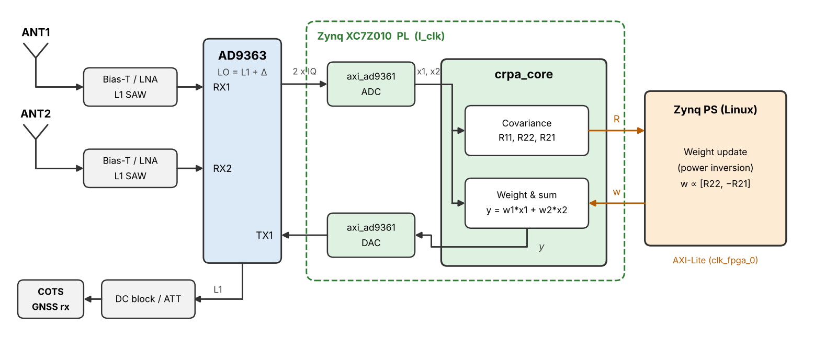

# pluto-crpa

Two-element CRPA (Controlled Reception Pattern Antenna) anti-jamming prototype on PlutoSDR (AD9363 + Zynq-7010).

Signals from two antennas are weighted and combined in the Zynq PL, then re-transmitted at GPS L1 to a commercial off-the-shelf (COTS) GNSS receiver. Adaptive weights are computed on the Zynq PS using power inversion.

> **Status:** Early development. The `crpa_core` combiner and covariance integrator run in the Pluto PL, and the PS application `crpa_ctl` drives them through UIO with an interrupt-driven weight loop. Fixed-weight tests at RF (T2) pass with a conducted GPS simulator signal and a COTS receiver: each element alone gives the same C/N0 as the plain pass-through (T1, about 3 dB below the direct reference); adding both elements in phase improves C/N0 by 1.8 dB (array gain, confirmed by a level-matched control run), and adding them in antiphase places a null about 20 dB deep. The inter-channel amplitude and phase (T3) are measured with a common signal: in the test cabling RX2 is 173 deg from RX1 and 0.3 dB lower, unchanged within about 1 deg by retunes, sample rate changes and power cycles; swapping the two splitter legs shows that this phase is the sum of a part inside the Pluto and a part in the test fixture. The conducted CW jammer test (T4) is done, with a separate CW source combined into both channels at a chosen inter-channel phase away from the simulator signal. Power inversion nulls the jammer by 19 to 20, 38 to 40 and 57 to 59 dB at jammer-to-noise ratios of 10, 20 and 30 dB, at the values of the bit-true model and independent of that phase separation. With fixed weights (one element, no CRPA) the receiver loses 4 and 10 dB of C/N0 at 10 and 20 dB and loses its fix at 30 dB. With power inversion it cold-starts and keeps a 3D fix at every jammer level. What the null costs depends on the phase separation between jammer and satellites, as predicted: at 100 deg C/N0 stays within 1 dB of the jammer-free value, at 30 deg it is 8 dB lower (predicted 9 dB), and at 3 deg the simulator signal is nulled together with the jammer (25 dB, receive-only). All satellites of the simulator share one inter-channel phase in this setup, so the test stands for one direction of arrival. Next: the jammer power sweep (T5). Interfaces and register maps may change.

## Overview



- Target signal: GPS L1 C/A (1575.42 MHz)
- Algorithm: power inversion (closed form for 2 elements)
- Signal path stays in the PL for low, fixed latency
- RX and TX LOs offset from L1 by the same amount, so no digital NCO is needed and LO leakage falls outside the C/A main lobe

## Goals

1. Demonstrate interference (CW / narrowband jammer) suppression with a two-element array, measured as C/N0 recovery on a COTS GNSS receiver.
2. Establish a verified flow from a Python bit-true model to Verilog RTL on a small FPGA.
3. Prepare the algorithms, fixed-point design and test procedures for a future multi-element CRPA with a discrete RF front end and multi-channel ADC.

## Roadmap

| Stage | Description | Status |
|---|---|---|
| T0 | Build the default Pluto design; record utilization and timing | Done |
| T0b | Remove the PL FIR decimator/interpolator to free DSP48 slices (72 -> 28 of 80) | Done |
| - | Verify the axi_ad9361 data interface | Done |
| - | Bit-true Python model | Done |
| T1 | PL pass-through RX1 -> TX1 with LO offset; COTS receiver gets a fix | Done (fix, C/N0, LO offset and sample rate sweep) |
| - | `crpa_core` RTL and testbench | Done (simulation) |
| - | `crpa_core` integration into the block design | Done (build, timing met; register and default-path check on hardware) |
| - | Device tree (UIO) and PS application | Done (fw/linux fork; `crpa_ctl`, dry run and RF) |
| T2 | Fixed weights ([1,0], [0,1], [1,1]); check combining gain | Done (each path; 1.8 dB array gain in phase; 20 dB null in antiphase) |
| T3 | Inter-channel amplitude/phase measurement with a common signal | Done (stable within about 1 deg over retunes, rate changes and power cycles; results in `results/t3.md`) |
| T4 | Conducted CW jammer; adaptive power inversion; null depth and C/N0 recovery | Done (null 19 to 59 dB at J/N 10 to 30 dB, as the model; fix held at J/N 30 dB where fixed weights lose it; C/N0 cost follows the jammer-to-satellite phase separation; `results/t4.md`) |
| T5 | Jammer power sweep; J/S improvement | Planned |
| T6 | Over-the-air test in a shielded environment (authorized only) | Planned |

Design resources with `crpa_core` (XC7Z010): LUT 72%, FF 60%, DSP48 56% (45 of 80), BRAM 3%; all timing constraints met. See [docs/pluto-crpa-plan.md](docs/pluto-crpa-plan.md) for details.

## Hardware

- ADALM-PLUTO **Rev C/D** (second RX/TX channel on u.FL), 2R2T mode
- Two L1 antennas spaced about lambda/2 (approx. 9.5 cm), with bias tees / LNAs as needed
- DC block between Pluto TX and the GNSS receiver, with at least 50 dB of Pluto TX attenuation plus any external attenuation

## Repository Layout

```
CLAUDE.md  Instructions for Claude Code
docs/      Development plan, setup guide, environment record, interface notes, register map
fw/        plutosdr-fw fork (submodule, branch crpa); fw/hdl and fw/linux are ADI forks (branch crpa)
ip/        crpa_core IP (Verilog): rtl/, tb/
model/     Python bit-true reference model
sw/        PS application crpa_ctl (sw/app) and patch exports of the fw/linux changes (sw/dts)
scripts/   Setup, build, simulation, hardware check, report and environment scripts
results/   Utilization/timing reports and measurement logs
```

`fw/`, `fw/hdl/` and `fw/linux/` are git submodules. The parent repository records a specific commit of each, not a branch; see [docs/setup.md](docs/setup.md).

## Getting Started

Requirements: Ubuntu 24.04 (or 22.04), AMD Vivado 2025.1. Full instructions, including host fixes for Ubuntu 24.04, are in [docs/setup.md](docs/setup.md).

```bash
git clone --recursive https://github.com/osqzss/pluto-crpa.git
cd pluto-crpa
./scripts/setup.sh

export VIVADO_SETTINGS=/tools/Xilinx/2025.1/Vivado/settings64.sh
./scripts/build_hdl.sh 2>&1 | tee results/build_hdl.log   # HDL build + reports in results/hdl/
```

PS application: `make -C sw/app` (cross-compiled with the toolchain of the firmware build), copied to the Pluto with `scp -O`; usage in [docs/pluto-crpa-plan.md](docs/pluto-crpa-plan.md), Section 7.

Full firmware build: `cd fw && make` (see `fw/README.md` and [docs/setup.md](docs/setup.md), Section 9). After an HDL change, delete `fw/build/system_top.xsa` first: the fw Makefile only copies it when it is missing, so the old bitstream would be packaged. Flashing: [docs/test-equipment.md](docs/test-equipment.md), Section 7.1.

## Documentation

- [docs/pluto-crpa-plan.md](docs/pluto-crpa-plan.md): design specification, status, task list and work rules
- [docs/setup.md](docs/setup.md): development environment setup
- [docs/environment.md](docs/environment.md): recorded host, Vivado and commit versions
- [docs/interface.md](docs/interface.md): axi_ad9361 data interface (CMOS, 2R2T)
- [docs/fixed_point.md](docs/fixed_point.md): `crpa_core` fixed-point design and simulated performance
- [docs/regmap.md](docs/regmap.md): `crpa_core` register map
- [docs/test-equipment.md](docs/test-equipment.md): GNSS test equipment, host tools and test safety rules

## Caution

Do not radiate jamming signals. All interference tests must be performed over cables or inside a shielded enclosure, in accordance with local radio regulations.

## License

TBD. Submodules (plutosdr-fw, ADI HDL, Linux, etc.) are under their own licenses.
